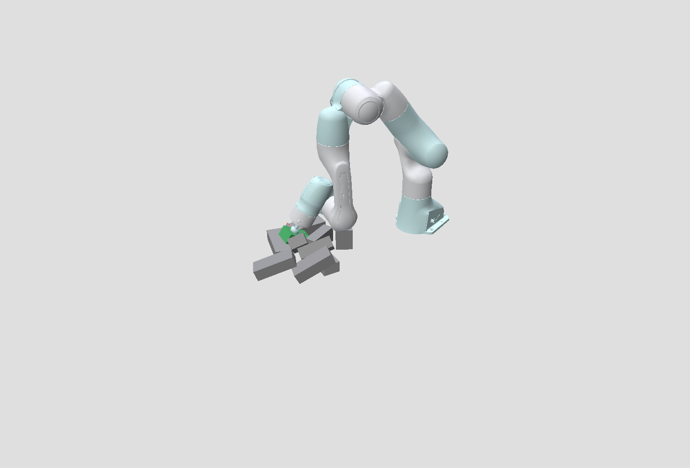
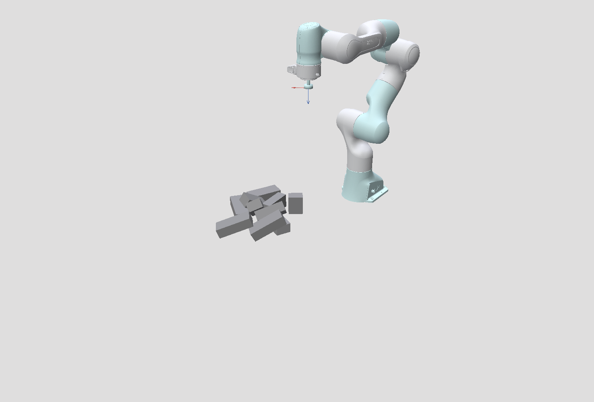

# Unload Minimal

**Interactive box unloading with MuJoCo physics, cuRobo motion planning, and Polyscope visualization.**

Unload Minimal generates a box pile, loads a saved scene, and lets you choose
each unloading action. It supports manual target editing, per-step disturbance
metrics, undo, and Blender animation export. Robot assets and configuration are bundled with
the project. No training pipeline, policy checkpoint, or input removal sequence
is required.

| Robot Approach | Pile Settling |
| --- | --- |
|  |  |

## Features

- **Scene Generation**: Create a single settled Temtsin box pile and save its geometry and material parameters.
- **Manual Selection**: Request IK filtering, click a candidate box and grasp face, and adjust the contact target.
- **Motion Planning**: Validate approach, contact, extraction, and return with cuRobo MotionGen.
- **Direct Removal**: Remove a selected IK candidate immediately, then simulate settling and score the result.
- **Frame Visualization**: Compare the actual EE frame with the translucent contact target frame.
- **Undo**: Restore the scene before an unload attempt, including metrics and animation history.
- **Timeline Replay**: Scrub recorded frames, step backward/forward, or play the unloading motion without changing the live scene.
- **Blender Export**: Export robot and box animation, materials, and metrics for MP4 or image-sequence rendering.

## Installation

Requires Linux, Python 3.11, and CUDA-enabled PyTorch.
Interactive unloading requires an NVIDIA GPU and an installed cuRobo build.
Polyscope requires an OpenGL display; headless scene generation does not.

### Create the Environment

```bash
conda create -n unload_minimal python=3.11.15 pip
conda activate unload_minimal
cd /path/to/unload_minimal

# Install the pinned scene-generation and visualization dependencies.
python -m pip install -e . --extra-index-url https://download.pytorch.org/whl/cu126

# Install build dependencies before building cuRobo against this PyTorch.
python -m pip install setuptools wheel 'setuptools-scm>=6.2' pybind11
python -m pip install --no-build-isolation -e '.[planning]' \
  --extra-index-url https://download.pytorch.org/whl/cu126
```

[pyproject.toml](pyproject.toml) specifies this project's runtime and asset-loading
dependencies. It installs dependency metadata; run the application scripts from
the complete project directory, including its bundled robot assets.

The `planning` extra provides the cuRobo `IKSolver` / `MotionGen` interfaces
used by this project (the v1-style API) and pins Warp to `1.12.1`.
Other transitive dependencies are provided by cuRobo's own dependency
declarations. The build tools in the setup command are only needed when building
cuRobo in a new environment.

The cuRobo source dependency is pinned to a commit tagged `v0.7.8`.
Building its CUDA extensions also requires a compatible CUDA toolkit
with `nvcc`, a C++ compiler, and an NVIDIA driver. These system components are
not installed by the TOML file. The PyTorch build recorded here targets CUDA
12.6. Both normal unloading and `--direct-remove` require cuRobo; generation and
scene viewing use the base dependencies.

This specification is not a complete Conda lockfile. Robot configuration comes
from the bundled suction robot YAML.

For subsequent sessions:

```bash
conda activate unload_minimal
cd /path/to/unload_minimal
```

## Quick Start

### Generate and View a Scene

```bash
# Generate one scene with 10 boxes; the default count is 30.
python scripts/scene_gen_temtsin.py --nb 10 --seed 42 --headless

# View the saved scene, with controls for settling, pausing, and resetting.
python scripts/view_scene.py scenes/box_10_42.npz
```

Omit `--headless` to open the generator UI and use `Pause / run` to start.
Generation saves a scene only after success. The default path is
`scenes/box_<count>_<seed>.npz`; use `--save-path scenes/my_scene.npz` to keep a
separate result. Relative save paths use the project root. Scene input paths
for the viewing and unloading scripts use the current working directory.

### Unload Interactively

```bash
# Plan and execute robot motion for each selected box.
python unload_play/view_unload.py scenes/box_10_42.npz

# Remove each selected box directly, then settle and score the remaining pile.
python unload_play/view_unload.py scenes/box_10_42.npz --direct-remove
```

1. Adjust the initial pile's X/Y position and yaw.
2. Click `Settle pile and compute IK` to confirm and lock placement.
3. Click a blue candidate box, then a face marker in the scene. Adjust the
   grasp position/orientation and extraction direction as needed.
4. Click `Validate with MotionGen`, then `Execute validated motion`. In direct
   mode, click `Remove selected box` instead.
5. After settling and scoring, click `Compute IK candidates` for the next step.

Candidate boxes and frames are selected in the scene, not from button lists.
IK never starts automatically on opening a scene or completing an unload.
Initial placement stays locked through planning failures and undo; only
`Reset to saved scene` unlocks it. `Undo last unload` restores a completed or
failed attempt after execution has stopped.

See [Interactive Unloading](docs/interaction.md) for target frames, selection,
undo behavior, timeline replay, recording, and Blender rendering.

After settling or completion, click `Replay recorded motion` to inspect the
recorded process. Drag `Replay frame`, use `Previous frame` / `Next frame`, or
click `Play replay` / `Pause replay`. `Exit replay` returns to the current live
scene with its selection and validated plan preserved.

### Configuration

```bash
python unload_play/view_unload.py scenes/box_10_42.npz \
  --max-settle-frames 1200 --ik-batch-size 256 --frames-per-render 1 \
  --export-dir exports --export-frame-stride 1
```

The default settling limit is 600 control frames, approximately 20 simulated
seconds. More frames per render speeds display advancement without changing
the physics timestep. Configuration modules live in `configs/`; see
[Physics and Metrics](docs/physics.md) for defaults and scene-generation options.

## Project Structure

```text
unload_minimal/
├── configs/                 # Physics, scene, motion, generation, and metric settings
├── docs/                    # Interaction and physics reference
├── figs/                    # Screenshots used in this README
├── robots/                  # Bundled URDF, meshes, materials, and cuRobo configuration
├── scripts/
│   ├── scene_gen_temtsin.py  # Single-scene generation
│   └── view_scene.py         # Saved-scene viewer
├── scenes/                  # Generated NPZ scenes
├── runtime/                 # Scene state, geometry, and persistent IK runtime
├── unload_play/             # Manual workflow, execution, undo, and Blender export
├── utils/                   # MJCF construction, visualization, settling, and metrics
├── exports/                 # Created only by an explicit animation export
└── pyproject.toml           # Project dependencies and environment settings
```

Robot paths resolve relative to this project, with no fallback to external
workspace assets. The installed cuRobo package and other installed libraries
remain dependencies; an editable package installation still relies on its own
source checkout. Blender exports include their own geometry and import scripts.

## Key Concepts

- **Candidates**: Blue boxes pass geometric filtering and have at least one
  successful IK target. Full motion feasibility is checked separately.
- **Contact Frame**: The desired EE +Z initially points into the box, opposite
  the surface normal. The translucent target displays the pose sent to planning.
- **Attachment**: MuJoCo mocap anchors and weld constraints carry the selected
  box during extraction and return.
- **Disturbance Metric**: Each step scores height changes of the remaining
  boxes between stable states. Lower is better; the score is not energy in joules.

## Dependencies

Project dependency versions:

| Dependency | Version | Role |
| --- | --- | --- |
| Python | 3.11.15 | Interpreter |
| MuJoCo | 3.9.0 | Rigid-body simulation |
| PyTorch | 2.9.0+cu126 | GPU tensors and cuRobo integration |
| cuRobo | Pinned source revision, tagged v0.7.8 | v1-style IKSolver / MotionGen interfaces |
| NumPy / SciPy | 2.4.3 / 1.17.1 | Geometry and numerical operations |
| Polyscope | 2.6.1 | Interactive visualization |
| pytorch-kinematics | 0.10.0 | Robot visual transforms |
| trimesh / pycollada | 4.12.2 / 0.9.3 | Robot mesh loading |
| PyYAML | 6.0.3 | Robot configuration |
| Warp | 1.12.1 | cuRobo dependency |

Blender runs separately using its own Python environment. The dependency
specification covers scene generation, visualization, and interactive unloading.

## Outputs

- **Scenes**: Generation writes NPZ files under `scenes/` with poses, dimensions,
  friction, density, and generation metadata.
- **Step Metrics**: Shown in the viewer and terminal, and retained in memory.
- **Animation Exports**: Click `Export recorded motion` after settling or
  completion to write `exports/<scene>/export_<UTC timestamp>/`.

Exports include `assets.npz`, `animation.npz`, `replay_manifest.json`,
`metric.txt`, and Blender import/render scripts. In Blender, open the exported
`blender_video.py`, run its default prepare mode, adjust `VideoCamera`, and
render. Set `Export frame stride` to 1 for all recorded frames.

The first animation frame is the settled pile before unloading. Idle UI and
planning time are excluded. Undo trims the in-memory recording, while existing
export directories remain unchanged. Viewing, unloading, and closing the
window never save a session automatically.
